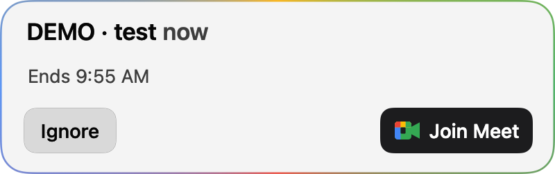
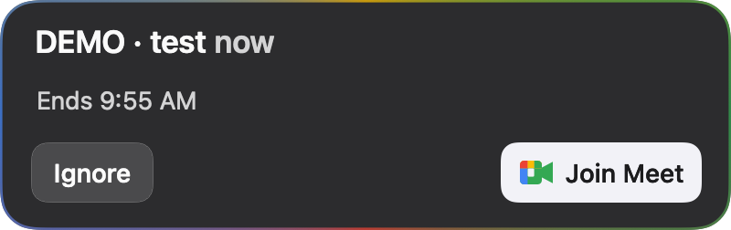
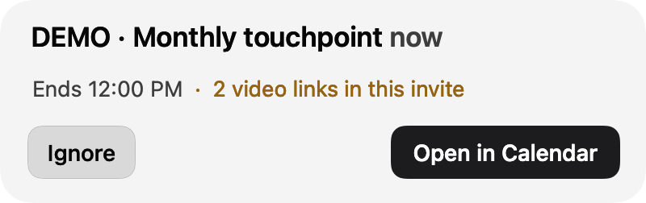
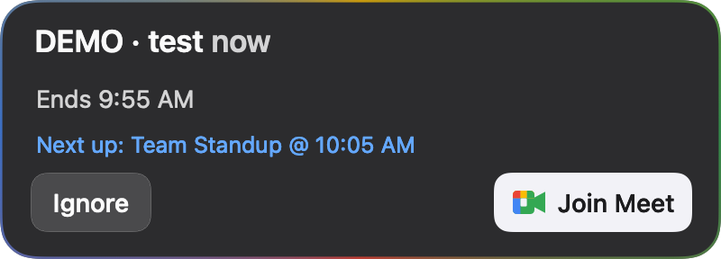

# MeetingCard

A small native macOS app that pops a card in the corner of your screen when a meeting is about to start: the title, a countdown, when it ends, and one **Join** button for the meeting's Meet / Zoom / Teams / Webex link. Inspired by the Live Calendar card in the Dia browser, but browser-independent.

| Light | Dark |
|---|---|
|  |  |
|  |  |

## What it does

- Polls your Google Calendar every 60 seconds and shows a card 2 minutes before a meeting starts ("in 2 min", "in 1 min", "now"). Cards sit bottom-right and stack upward when meetings overlap.
- Finds every video link in the invite (location, Meet link, conference data, description) and dedupes them by meeting, not by URL text. One distinct link gives **Join Meet / Zoom / Teams / Webex**. Two or more give an amber "2 video links in this invite" note and **Open in Calendar** instead of a guess.
- Re-checks the event right before showing and every 10 seconds while the card is up: a cancelled or declined meeting closes the card, a moved one reschedules, and title or link changes update in place.
- Shows a "Next up" line for back-to-back meetings, follows light/dark mode, and draws a thin outline in the provider's color.
- Return joins and Esc ignores, but only after you click or hover the card. A card never steals keyboard focus from the app you are typing in.
- No Dock icon and no window. One small menu bar icon for the optional [call coach](#call-coach), with **Turn On Call Coach** while it's off. Registers itself as a login item the first time the installed copy runs.

Only timed events with a video link get a card, plus invites from someone else that have neither a link nor a location (probably a missing link). All-day events, focus time, out-of-office, working location and declined events are skipped.

## Requirements

- macOS 15 or later on Apple Silicon (the project builds `arm64` only; Intel support is an open contribution).
- Xcode 26 (CI builds with 26.6; older Xcode versions are untested), and [xcodegen](https://github.com/yonaskolb/XcodeGen) (`brew install xcodegen`).
- The Google Workspace CLI, [`gws`](https://github.com/googleworkspace/cli), signed in to the Google account whose calendar you want. This is the only calendar source today (see [Roadmap](#roadmap)).

### Setting up gws

1. Install it: `brew install googleworkspace-cli`, or a release binary, or `cargo install` (see the gws README). The npm package needs Node on `PATH`, which an app launched from Finder usually does not have, so prefer one of the native installs.
2. gws uses your own Google Cloud OAuth client. Either run `gws auth setup` (needs `gcloud`), or create a **Desktop app** OAuth client in the Google Cloud Console, enable the Google Calendar API, and save the client JSON as `~/.config/gws/client_secret.json`.
3. Sign in: `gws auth login --readonly -s calendar`. For a personal Gmail account with an unverified OAuth app, add yourself as a test user on the consent screen first.
4. Check it: `gws calendar events list --params '{"calendarId":"primary","maxResults":3}'` should print JSON.

MeetingCard looks for `gws` in `$MEETING_CARD_GWS` (an absolute path), then `~/.local/bin`, `/opt/homebrew/bin`, `/usr/local/bin` and `~/.cargo/bin`. It only ever reads events (`events list` and `events get` on your primary calendar).

**Never run gws with a stripped environment** (for example `env -i ...`). If gws cannot reach its keyring it may delete its stored credentials. MeetingCard always passes your full environment with `HOME`, `USER`, `LOGNAME` and `PATH` forced, and stops polling if gws reports that it removed credentials.

## Build and install

```sh
git clone https://github.com/SLatz18/meeting-card.git
cd meeting-card/swift
./scripts/build.sh          # generate the Xcode project, run the tests, Release build, sign, install
open ~/Applications/MeetingCardSwift.app
```

`./scripts/build.sh test` runs the tests only, and `./scripts/build.sh build` builds and signs without installing. The script never launches or kills the app.
Add `--test-id` (for example `./scripts/build.sh build --test-id`) for a separate test build, "MeetingCard (Test)" (`com.slatz.meetingcard.swift.test`), with its own settings, Keychain item and privacy grants; see [docs/MAC_DEMO_CHECKS.md](docs/MAC_DEMO_CHECKS.md).

### Signing

There is no Apple Developer ID involved. `build.sh` signs with, in order:

1. `$SIGN_IDENTITY`, if you set it;
2. a Keychain code-signing identity named `Local Self-Signed`, if you have one;
3. otherwise **ad-hoc** (`codesign -s -`).

Ad-hoc is fine for trying it out. A stable self-signed identity is nicer for daily use, because macOS then treats each rebuild as the same app (the login-item approval sticks). To make one: Keychain Access > Certificate Assistant > Create a Certificate, name it `Local Self-Signed`, type Self Signed Root, certificate type Code Signing. Hardened runtime stays off on purpose: without a Team ID, library validation would reject the app's own embedded framework.

## Run, quit, turn off

- Start: `open ~/Applications/MeetingCardSwift.app`. The first run from `~/Applications` registers it as a login item.
- Quit: `pkill -f MeetingCardSwift.app/Contents/MacOS/MeetingCardSwift`.
- Stop launching at login: System Settings > General > Login Items, switch MeetingCardSwift off. The app never re-enables itself.
- Log: `~/Library/Logs/MeetingCardSwift.log`. It records event ids, start times, counts and skip reasons, never titles, descriptions or attendees. It **does** record the meeting link a card offers and the link opened on Join, which can include a Zoom passcode, so redact links before sharing log lines.

## Try it without a calendar

Fixture mode renders one card from a JSON file and never calls gws or polls:

```sh
./scripts/build.sh build
./scripts/show-fixture.sh meet light        # bottom-left, titled "DEMO · ..."
./scripts/show-fixture.sh multilink dark 5 --snapshot /tmp/card.png
```

Fixtures live in `swift/Tests/Fixtures/`. Developer seams (`--snapshot`, `--appearance`, `MEETING_CARD_SELFTEST`, `MEETING_CARD_DRY_JOIN`, and others) are documented in [`swift/README.md`](swift/README.md).

## Call coach

Call coach is an optional helper for your calls. If you interrupt someone, talk over them, sound aggressive, or miss a question, the edge of your screen glows. Nobody else on the call sees it. How it decides is in [docs/how-it-works.md](docs/how-it-works.md).

**What the colors mean**
- **Red:** you interrupted, talked over someone, or sounded aggressive.
- **Amber:** you may not be listening, someone asked a question you didn't answer, or you've been doing most of the talking.

**How it starts**
Call coach is off by default. Once you turn it on (in Settings, or **Turn On Call Coach** in its menu bar menu), it starts by itself when a call app is using both your mic and your speakers. You can also start it by hand with **Start now** in Settings. A meeting you join from a card gets the coach ready (the chip shows **On**); clicking **Pause** there (or **Skip This Call** in the menu) skips coaching for that call. It stops about 30 seconds after the call app releases your mic and speakers.

**How to pause**
Click **Pause** on the coach chip on the meeting card, or in the coach's menu bar menu. Click **Resume** to turn it back on. While the coach is running, the chip shows **Listening** (or **Paused**), and the menu shows the same state at the top. The menu bar icon is dimmed while the coach is off or paused.

**Privacy**
- While the coach is on with an API key, call audio and transcripts go to OpenAI on your own key. No audio is sent when it's off or paused.
- Without a key (or while OpenAI rejects the saved one), the coach runs only its on-device cues (interruptions, talking over, long monologues, talk share) and nothing leaves your Mac. The menu shows **GPT cues off**.
- Nothing is saved. There are no transcripts, stats or recaps, nothing is stored on disk, and nothing about the call is logged (the coach logs only counters and states). Audio exists only in memory (RAM) while it's being processed.
- Your API key is stored in the macOS Keychain, never synced. Keychain caveat: the key is saved with "this device only" (`kSecAttrAccessibleWhenUnlockedThisDeviceOnly`), but the login keychain ignores that setting. It takes effect only once a properly signed build (with a team ID) stores the key in the data-protection keychain. Builds from `build.sh` are ad-hoc or self-signed, so today the key sits in your login keychain like any other saved password.

**Setup**
Reopen MeetingCard (double-click it in Finder, or `open ~/Applications/MeetingCardSwift.app` while it runs) to open Settings. Turn on Call coach, then allow mic and system audio recording when macOS asks. Add your OpenAI API key for the GPT cues; without one the on-device cues still run.

**For IT and admins**
- Opt-in: the boolean UserDefaults key `coach.enabled` in the `com.slatz.meetingcard.swift` domain (absent or false = off). Other settings: `coach.anyApp`, `coach.allowlist` (bundle IDs), `coach.onboarded`.
- API key: Keychain generic password, service `com.slatz.meetingcard.swift.openai`, account `OPENAI_API_KEY`, never synchronizable. `kSecAttrAccessibleWhenUnlockedThisDeviceOnly` is requested on every save, but the login keychain ignores it. It is enforced (readable only while unlocked, never migrated) only once a properly signed build, with a team ID, uses the data-protection keychain. The app tries that keychain first and falls back to the login keychain on `errSecMissingEntitlement`, which is what ad-hoc and self-signed builds from `build.sh` get.
- Network: `api.openai.com` only (realtime transcription WebSocket, Responses API with `store: false`, `GET /v1/models` to check the key), only while the coach is on, not paused, and has a key.
- Permissions (TCC): Microphone, System Audio Recording (Core Audio process taps), and Screen Recording (ScreenCaptureKit's audio-only call capture). Reset with `tccutil reset Microphone|AudioCapture|ScreenCapture com.slatz.meetingcard.swift`.
- A `build.sh --test-id` build uses `com.slatz.meetingcard.swift.test` instead, for the defaults domain, the TCC grants and the Keychain service (`com.slatz.meetingcard.swift.test.openai`).

**Screen sharing**
The glow and the coach chip's card ask macOS to leave them out of screen captures (`NSWindow.sharingType = .none`). A CI probe (`ScreenShareProbeTests`) captures the display with ScreenCaptureKit, which current Zoom, Teams, Meet and Webex builds use to share a screen. On macOS 26.7.2 (25G332) it found our windows absent from the captured pixels while an ordinary window was present, so people you share your screen with don't see the glow. Our windows still appear in ScreenCaptureKit's window list, so an app could offer them as a pick in a "share a window" menu; picking one shares nothing visible. Sharing tools that use older capture paths are untested. If one shows the glow, pause the coach from the chip while you share.

## Project layout

- `swift/Core/`: `MeetingCardCore.framework`, Foundation only. Event parsing, link detection and dedupe, timing, scheduler, the gws runner, logging, and the controller logic.
- `swift/App/`: the AppKit shell (the card panel, drawn provider icons, timers, the call coach UI).
- `swift/Packages/ListenMoreKit/`: the call coach, a local Swift package and its single source (capture, voice activity, local and transcript rules, OpenAI client, glow). Rule constants live in one place, `DefaultConfig.swift`. It runs in-process: no helper or interpreter.
- `docs/`: [how the coach works](docs/how-it-works.md), the [signing plan](docs/SIGNING_PLAN.md) (unsigned for now), and [Mac demo checks](docs/MAC_DEMO_CHECKS.md) run by hand.
- `swift/Tests/`: XCTest bundle for Core (no app host).
- `swift/project.yml`: xcodegen spec. The `.xcodeproj` is generated and not committed.

## Roadmap

Open ideas live in the issue tracker. The big ones:

- More calendar sources: Sign in with Google, macOS Calendar (EventKit), Microsoft 365. This would remove the gws requirement.
- More settings and a Control Center control (pause, lead time, corner, calendars). The Settings window covers only the call coach today.
- Open Zoom links straight in the Zoom app.
- A split button for invites with several video links.
- A "+N more" cap for tall stacks of cards.
- Hide or redact cards during screen sharing.

## Contributing

Contributions are welcome. Start with [CONTRIBUTING.md](CONTRIBUTING.md), and look for issues labelled `good first issue`. Please report security problems privately, as described in [SECURITY.md](SECURITY.md).

## License

[MIT](LICENSE)
