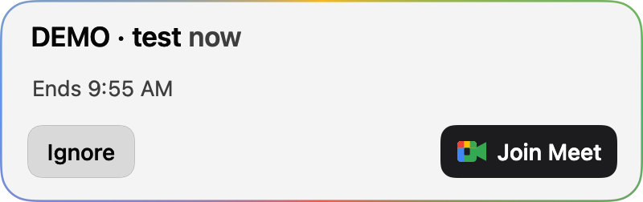
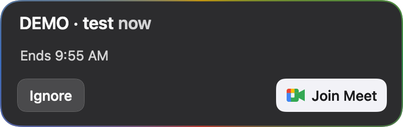
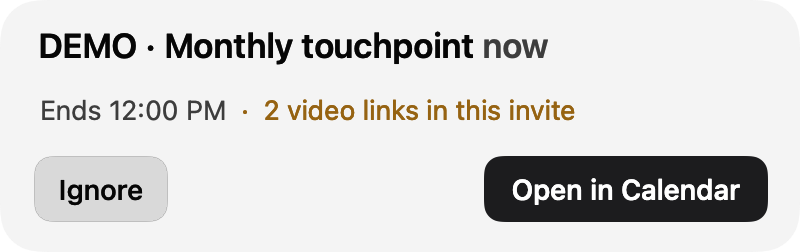
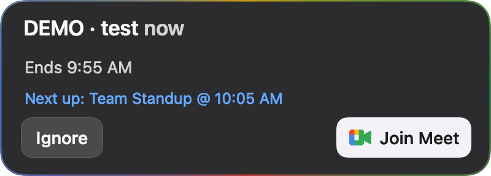

# MeetingCard

A small native macOS app that pops a card in the corner of your screen when a meeting is about to start: the title, a countdown, when it ends, and one **Join** button for the meeting's Meet / Zoom / Teams / Webex link. Inspired by the Live Calendar card in the Dia browser, but browser-independent.

| Light | Dark |
|---|---|
|  |  |
|  |  |

## What it does

- Polls your Google Calendar every 60 seconds and shows a card 2 minutes before a meeting starts ("in 2 min", "in 1 min", "now"). Cards sit bottom-right and stack upward when meetings overlap.
- Finds every video link in the invite (location, Meet link, conference data, description) and dedupes them by meeting, not by URL text. One distinct link gives **Join Meet / Zoom / Teams / Webex**. Two or more give an amber "2 video links in this invite" note and **Open in Calendar** instead of a guess.
- Re-checks the event right before showing and every 10 seconds while the card is up: a cancelled or declined meeting closes the card, a moved one reschedules, and title or link changes update in place.
- Shows a "Next up" line for back-to-back meetings, follows light/dark mode, and draws a thin outline in the provider's color.
- Return joins and Esc ignores, but only after you click or hover the card. A card never steals keyboard focus from the app you are typing in.
- No Dock icon, no menu bar icon, no window. Registers itself as a login item the first time the installed copy runs.

Only timed events with a video link get a card, plus invites from someone else that have neither a link nor a location (probably a missing link). All-day events, focus time, out-of-office, working location and declined events are skipped.

## Requirements

- macOS 15 or later on Apple Silicon (the project builds `arm64` only; Intel support is an open contribution).
- Xcode 26 (CI builds with 26.6; older Xcode versions are untested), and [xcodegen](https://github.com/yonaskolb/XcodeGen) (`brew install xcodegen`).
- The Google Workspace CLI, [`gws`](https://github.com/googleworkspace/cli), signed in to the Google account whose calendar you want. This is the only calendar source today (see [Roadmap](#roadmap)).

### Setting up gws

1. Install it: `brew install googleworkspace-cli`, or a release binary, or `cargo install` (see the gws README). The npm package needs Node on `PATH`, which an app launched from Finder usually does not have, so prefer one of the native installs.
2. gws uses your own Google Cloud OAuth client. Either run `gws auth setup` (needs `gcloud`), or create a **Desktop app** OAuth client in the Google Cloud Console, enable the Google Calendar API, and save the client JSON as `~/.config/gws/client_secret.json`.
3. Sign in: `gws auth login --readonly -s calendar`. For a personal Gmail account with an unverified OAuth app, add yourself as a test user on the consent screen first.
4. Check it: `gws calendar events list --params '{"calendarId":"primary","maxResults":3}'` should print JSON.

MeetingCard looks for `gws` in `$MEETING_CARD_GWS` (an absolute path), then `~/.local/bin`, `/opt/homebrew/bin`, `/usr/local/bin` and `~/.cargo/bin`. It only ever reads events (`events list` and `events get` on your primary calendar).

**Never run gws with a stripped environment** (for example `env -i ...`). If gws cannot reach its keyring it may delete its stored credentials. MeetingCard always passes your full environment with `HOME`, `USER`, `LOGNAME` and `PATH` forced, and stops polling if gws reports that it removed credentials.

## Build and install

```sh
git clone https://github.com/SLatz18/meeting-card.git
cd meeting-card/swift
./scripts/build.sh          # generate the Xcode project, run the tests, Release build, sign, install
open ~/Applications/MeetingCardSwift.app
```

`./scripts/build.sh test` runs the tests only, and `./scripts/build.sh build` builds and signs without installing. The script never launches or kills the app.

### Signing

There is no Apple Developer ID involved. `build.sh` signs with, in order:

1. `$SIGN_IDENTITY`, if you set it;
2. a Keychain code-signing identity named `Local Self-Signed`, if you have one;
3. otherwise **ad-hoc** (`codesign -s -`).

Ad-hoc is fine for trying it out. A stable self-signed identity is nicer for daily use, because macOS then treats each rebuild as the same app (the login-item approval sticks). To make one: Keychain Access > Certificate Assistant > Create a Certificate, name it `Local Self-Signed`, type Self Signed Root, certificate type Code Signing. Hardened runtime stays off on purpose: without a Team ID, library validation would reject the app's own embedded framework.

## Run, quit, turn off

- Start: `open ~/Applications/MeetingCardSwift.app`. The first run from `~/Applications` registers it as a login item.
- Quit: `pkill -f MeetingCardSwift.app/Contents/MacOS/MeetingCardSwift`.
- Stop launching at login: System Settings > General > Login Items, switch MeetingCardSwift off. The app never re-enables itself.
- Log: `~/Library/Logs/MeetingCardSwift.log`. It records event ids, start times, counts and skip reasons, never titles, descriptions or attendees. It **does** record the meeting link a card offers and the link opened on Join, which can include a Zoom passcode, so redact links before sharing log lines.

## Try it without a calendar

Fixture mode renders one card from a JSON file and never calls gws or polls:

```sh
./scripts/build.sh build
./scripts/show-fixture.sh meet light        # bottom-left, titled "DEMO · ..."
./scripts/show-fixture.sh multilink dark 5 --snapshot /tmp/card.png
```

Fixtures live in `swift/Tests/Fixtures/`. Developer seams (`--snapshot`, `--appearance`, `MEETING_CARD_SELFTEST`, `MEETING_CARD_DRY_JOIN`, and others) are documented in [`swift/README.md`](swift/README.md).

## Project layout

- `swift/Core/`: `MeetingCardCore.framework`, Foundation only. Event parsing, link detection and dedupe, timing, scheduler, the gws runner, logging, and the controller logic.
- `swift/App/`: the AppKit shell (the card panel, drawn provider icons, timers).
- `swift/Tests/`: XCTest bundle for Core (no app host).
- `swift/project.yml`: xcodegen spec. The `.xcodeproj` is generated and not committed.

## Roadmap

Open ideas live in the issue tracker. The big ones:

- More calendar sources: Sign in with Google, macOS Calendar (EventKit), Microsoft 365. This would remove the gws requirement.
- A settings window and a Control Center control (pause, lead time, corner, calendars).
- Open Zoom links straight in the Zoom app.
- A split button for invites with several video links.
- A "+N more" cap for tall stacks of cards.
- Hide or redact cards during screen sharing.

## Contributing

Contributions are welcome. Start with [CONTRIBUTING.md](CONTRIBUTING.md), and look for issues labelled `good first issue`. Please report security problems privately, as described in [SECURITY.md](SECURITY.md).

## License

[MIT](LICENSE)
