# Coaching display: how the coach's cues show during a call

Status: proposal, with a prototype in the **test build only** (draft PR #31). Nothing here changes the shipping
app. **All new copy is placeholder** (`CueDisplayCopy.isPlaceholder`); the cue words and VoiceOver announcements
it shows are the shipped, approved `CoachNudge.words` and `CoachNudge.announcement`.

**Decision (owner, 2026-11-18):** the card shows the rotating words line, then the cue's glyph lingers in the
status glyph; the pill is the glyph state, with the words in its tooltip and VoiceOver label. Both ship in the
follow-up PR stacked on #31 (CC4 in [MAC_DEMO_CHECKS.md](MAC_DEMO_CHECKS.md)). Still open, with the proposals
below as the defaults: the 10 s gap, the glyph set and the final copy (to a writer). In the shipped card the
glyph is the cue's from the moment the words show, so the two are learned together; the prototype's rotating
line keeps the coach glyph during the words.

**Recommendation in one line:** keep the shipped rotating line on the card, let the cue's glyph linger in the
status glyph after the words go, put the glyph state on the pill, and leave caption anchoring for later.
[Reasoning below](#recommendation).

- [1. Cue inventory](#1-cue-inventory-from-the-code)
- [2. Constraints, and the pacing constant N](#2-constraints-and-the-pacing-constant-n)
- [3. Options](#3-options)
- [4. Snapshots](#4-snapshots)
- [Recommendation](#recommendation)
- [Open questions for the owner](#open-questions-for-the-owner)
- [Comparing the options on a Mac](#comparing-the-options-on-a-mac)
- [How the evidence was gathered](#how-the-evidence-was-gathered)

## 1. Cue inventory (from the code)

ListenMoreCore can emit seven cue types (`CueType` in `ListenMoreCore/CuePolicy.swift`; the card mirrors them as
`CoachNudge.Kind`). Thresholds are the built-in config (`ListenMoreCore/DefaultConfig.swift`).

| Cue | Source and trigger | Tone | Priority | Urgency | Mid-sentence? | Card words (shipped) |
|---|---|---|---|---|---|---|
| `talk_over` | Local audio (`LocalLayer.talkOver`): at least 3 speaker switches within 4 s, at least 100 ms of real overlap, and the user ends up holding the floor (they've talked 1 s since the other side stopped). Skipped when the switches are a number read-back (needs a transcript). | rose | 1 | now | yes: stop and yield | You're both talking |
| `interrupt` | Local audio (`LocalLayer.cutIn`) gated by the transcript (`CoachPipeline.cutInVerdict`): the user starts while the other side talks (or in a pause under 300 ms), the overlap reaches 600 ms, they keep talking 500 ms more, and the user's utterance passes 1.2 s (longer is not a backchannel). A short overlap that ends with them stopping fires only if their last words were unfinished. Dropped when the user is answering a question asked in the last 3 s; none within 20 s after a talk-over or 1 s after unmute. Fires about 1.2 s after the user starts. | rose | 2 | now | yes: let them finish | Let them finish |
| `missed_question` | Transcript rule (`TextRules`, needs a key): the other side asks a question (in a 1:1, or naming the user in a group) and the user's reply shares too few words with it and isn't a direct answer. Soft after 8 words or at the end of the user's turn; strong after 20 s of the user's voice in the reply. Cleared by an answer; dropped after 2 user turns or 45 s after someone else answered. The TypeSafe judge can also decide it. | amber | 3 | next turn | partly: answer at the next breath | Answer their question |
| `aggressive` | Transcript rule (`TextRules.heat`, needs a key): absolutes, frustration words, profanity, contradiction openers and repeated clauses, scored over 15 s windows; vetoed by an apology or a personal topic; once per user turn; never in the first 5 minutes of a call; lexicon-only heat also needs a loudness or speaking-rate rise. The TypeSafe judge can also decide it. | rose | 4 | next sentence | no: soften the next sentence | Ease the tone |
| `monologue` | Local audio (`LocalLayer.monologue`): the user's run passes 60 s (soft) and 90 s (strong); soft earlier (from 30 s) when the run is 2.5× the user's median run; both doubled right after a how/why question; none during the user's slot in a round of updates. | amber | 5 | now | yes: wrap up | Pause and hand over |
| `not_listening` | GPT judge (or TypeSafe) on the user's reply right after the other side made a point of at least 4 words; confidence at least 0.85; skipped during a run of 30 s or more. **Off by default in MeetingCard** (`CoachController.configOverrides` disables it). | amber | 6 | next turn | no | Respond to their point |
| `talk_share` | Local audio (`LocalLayer.talkShare`): the user's share of speech over a rolling 10 min passes 70% (1:1) or 65% (group), once at least 5 min of speech has been heard; re-arms below the limit minus 5 points. | amber | 7 | trend | no | Leave room for others |

How cues reach the card (`CuePolicy`, applied in the engine's pipeline and again in `CoachSession`): one cue at a
time; **no cue within 20 s of any other cue** (`cues.global_cooldown_s`) and none within 20 s of the same type
(`cues.cooldown_s`); candidates raised together are tried in priority order; a held cue is **dropped, not
queued**. The card then shows a cue's words for 4.5 s (`CardStyle.Coach.nudgeHold`), and the glow plays once
(about 3 s). So with the shipped config **the display never sees more than one cue per 20 s** (at most 3 a minute).

### Frequency in the harness

From ListenMoreHarness (draft PR #30, read only) run offline on this machine: the real pipeline on synthetic
voices, scripted transcription, a judge that always says none. Its nine scenarios are written to trigger one rule
each, so these are **not natural call rates**; they show latency and spacing. I added one more script, a busy
call that packs several rules into 98 s (it is not in #30 or this PR's code; its lines and cue times are recorded
in `CueTimelines.swift`), and re-ran everything with both cooldowns at 0 to see what the rules raise before pacing.

| Scenario | Length | Cues shown (shipped pacing) | Before pacing |
|---|---|---|---|
| interruption | 27 s | interrupt at 14.4 s (1.2 s after the user started) | same |
| monologue | 86 s | monologue (soft) at 67.4 s | same |
| missed-question | 40 s | missed_question (soft) at 35.0 s (0.2 s after the reply ended) | same |
| mute-unmute | 51 s | interrupt at 45.2 s | same |
| pause | 47 s | interrupt at 3.6 s and 41.0 s | same |
| silence-to-stop, two-them-voices | 11 s, 34 s | none | none |
| no-key, cost-cap | 27 s, 19 s | interrupt at 14.4 s, 14.2 s | same |
| busy (added) | 98 s | interrupt 7.7 s, talk_over 29.6 s, monologue 77.7 s | **plus missed_question at 24.5 s**, 5.1 s before the talk-over |

Across 7.3 minutes of scripted speech: 11 cues shown (interrupt 7, monologue 2, talk_over 1, missed_question 1),
never closer than 21.9 s. The only cue the policy held was the busy call's missed question ("answer their
question"), 16.8 s after an interrupt and 5.1 s before a talk-over ("you're both talking"): two cues that ask
opposite things, close together. That is the one real conflict the evidence shows. Not exercised by any harness
script: `aggressive` (needs 5 minutes of call), `talk_share` (needs 5 minutes of speech), `not_listening` (off in
MeetingCard, and the offline judge says none) and the strong levels.

## 2. Constraints, and the pacing constant N

- **Calm by default**: no flashing, no sound, no new motion. **At most one new cue per N seconds, N = 10 s**
  (`CueDisplayPacing.minNewCueGap`), one gate shared by every option:
  - **N ≥ 2 × the 4.5 s nudge hold**: every cue gets its whole hold, then the card rests in its normal state at
    least as long, so two cues never read as one element blinking between states.
  - **N ≤ the policy's 20 s global cooldown**: with the shipped config the gate never delays or drops a cue the
    policy let through. Pacing stays the engine's job, where the harness tests it; the gate only acts if a
    config change or a judge provider lets cues through faster (the "before pacing" and burst timelines).
  - 10 s is about 26 spoken words (`TextRules` estimates 2.6 words/s): at most one new instruction per couple of
    sentences.
  - Inside the gap a new cue waits (one deep). A newer cue that asks the opposite (stop talking vs. answer)
    replaces the waiting one; otherwise the higher priority keeps the place. When the gap opens the waiting cue
    shows only if it is still within its **shelf life** (`CoachNudge.Kind.shelfLife`: interrupt and talk-over
    6 s from onset, not-listening 10 s, aggressive 15 s, missed question 20 s, monologue 30 s, talk share 60 s,
    each from that rule's own window). Too late is dropped, never shown late.
  - A shown cue that is still lingering is cleared early by a newer cue that asks the opposite.
- **Readable at a glance while talking**: the instruction itself (3 or 4 words) or one glyph, never a sentence.
- **Theme tokens only**: every size, color and duration comes from `Theme`/`CardStyle` (the prototype adds
  `Theme.CueDisplay`, derived from them; `CueDisplayTests` fails on a literal). **Glyph rule kept**: mic glyphs
  stay on Mute in Zoom only, `waveform`/`waveform.slash` stay the coach's hearing state, the ear stays the
  coach. Cue glyphs use none of them (tested): hand.raised.fill (interrupt), bubble.left.and.bubble.right.fill
  (talk over), thermometer.medium (aggressive), arrowshape.turn.up.left.fill (not listening),
  questionmark.bubble.fill (missed question), timer (monologue), chart.pie.fill (talk share).
- **VoiceOver**: every option keeps the shipped announcement when a cue shows (`CoachNudge.announcement`), so
  VoiceOver users get the words whatever is drawn. New labels: see each option.
- **Light and dark**: all snapshots in both. (The prototype draws standard-contrast tones; Increase Contrast
  would use the shipped card's dynamic colors and isn't shown.)
- **No new permissions or entitlements, no plist change.** None is needed: it's drawing only. The shipping build
  doesn't contain the prototype at all (CI reads both binaries).

## 3. Options

All four draw only inside the coach card's panel, which screen shares leave out (`CoachSurface.sharing` is
`.excluded`; the CI probe of ScreenCaptureKit is report-only and the CC5 hand check covers it). None adds a window
or anything outside the card, so **screen sharing is the same for every option**: nothing new is shared. The
burst column assumes the gate above; with the shipped policy no option ever sees a burst.

### A. Rotating line (the shipped behavior, made explicit) — prototyped

The status line turns into the cue's words in the nudge band (tone tint, outline, leading bar) for 4.5 s, then
returns to "Coach on, listening". The pill tints and widens for the words.

- **Bursts**: one new cue per 10 s; the rest wait or drop as above. Mid-burst the card rests.
- **Stale**: words vanish after the hold, so nothing stale stays up; a waiting cue past its shelf life is dropped.
- **Conflicts**: never two at once; the gate keeps opposite advice 10 s apart at least.
- **Small or collapsed**: the pill widens for the words (up to the card's width). That width change is the most
  visible motion of any option.
- **VoiceOver**: unchanged: the band reads the words, the announcement fires on show.
- **Trade-off**: the words are the instruction, readable in one glance, best for the urgent "now" cues
  (interrupt, talk-over, monologue). But they last 4.5 s: a user who doesn't glance in that window misses them
  (the glow helps).

### B. Short stack with decay — on paper only

The last two or three cues in a list under the status line, newest on top, each fading over 60 s with its age.

- **Bursts**: shows all of them, which is the opposite of calm; with the gate, rarely more than one.
- **Stale**: decays visibly; old items read as history, not instructions.
- **Conflicts**: opposite advice can sit side by side ("Answer their question" above "You're both talking").
- **Small or collapsed**: doesn't fit the pill; the pill would fall back to A or C.
- **Why not built**: with shipped pacing the stack holds one item almost always (the harness never showed two
  cues within 20 s), so it costs a caption row for nothing, and when it does hold two they may contradict.

### C. Glyph state, details on hover — prototyped

The status line keeps "Coach on, listening". The status glyph turns into the cue's glyph in its tone for the 4.5 s
hold, then stays as the same glyph in the held text role while it lingers (20 s, the policy's per-type cooldown,
so it's gone before the same cue can return), with the band's leading bar fading out. Hovering the card shows the
words and the age ("Just now", "12 s ago", placeholder) in the band; the pill shows a tooltip. The pill never
widens.

- **Bursts**: the glyph changes at most once per 10 s; no width change, no tint flash.
- **Stale**: the two-step decay (tone, then neutral, then gone) shows age without words.
- **Conflicts**: the newest glyph replaces the older; an opposite cue clears it early.
- **Small or collapsed**: the best fit: the pill keeps its size and shape; the glyph carries the cue.
- **VoiceOver**: the announcement fires on show; while the glyph lingers, the status reads "Coach on, listening.
  Last cue: Let them finish, 12 s ago." (placeholder).
- **Trade-off**: calmest, and a later glance still catches a recent cue. But a glyph has to be learned (seven of
  them), and decoding it takes longer than reading the words, which matters most for the urgent cues.

### D. Caption-anchored — prototyped

The rotating line, plus a mark on the caption row that triggered the cue: the nudge tint across the row and the
cue's glyph in the gutter to its left. Interrupt marks the line that was cut into, missed question the question,
talk-over, aggressive, not-listening and monologue the user's own line; talk share (a trend) marks nothing. The
mark lingers like C and leaves when its row scrolls out of the three caption rows.

- **Bursts**: same gate as A; the mark moves at most once per 10 s.
- **Stale**: the mark goes when its row scrolls out, which in quick back-and-forth is fast (in the harness
  interruption it left 8.5 s after the cue).
- **Conflicts**: the newer cue's mark replaces the older one.
- **Small or collapsed**: the pill has no captions, so it is A there.
- **Captions off** (the default; they need a key and an opt-in): no rows to mark, so it is A.
- **VoiceOver**: the marked row reads "Cue: Let them finish. Them: …" (placeholder).
- **Trade-off**: the only option that says *what* the cue is about, which helps the slower cues (a missed question
  points at the question). But it adds a second changing element, depends on captions being on, and the line it
  points at is often already gone.

| | A. Rotating line | B. Stack | C. Glyph state | D. Caption-anchored |
|---|---|---|---|---|
| Glance cost while talking | lowest: the words | high: a list | low, once learned | low (the words), plus a second element |
| A cue missed if you don't look for 4.5 s | lost | kept | kept (20 s) | kept while the row shows |
| Motion | band tint, pill widens | list changes | glyph change only | band tint, row mark |
| Pill | widens | doesn't fit | best fit | = A |
| Works with captions off | yes | yes | yes | = A |
| Opposite advice side by side | never | possible | never | never |

## 4. Snapshots

Rendered by `CueDisplaySnapshotTests` (macOS CI, the `cue-display-snapshots` artifact); compressed copies in
`docs/coaching-display/`. Card and pill: the busy call (harness, shipped pacing) at 30.5 s, during the talk-over
cue. Strips: the surface at several moments of a timeline, each labelled with its time.

### The card, during a cue

| | Light | Dark |
|---|---|---|
| A. Rotating line | 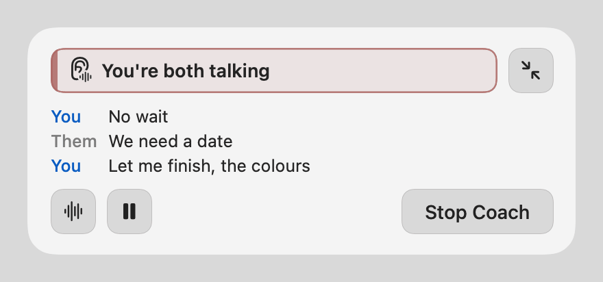 | 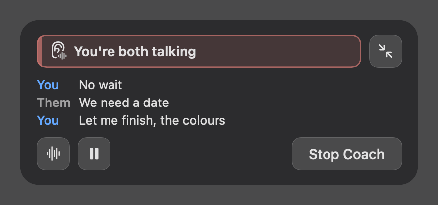 |
| C. Glyph state | 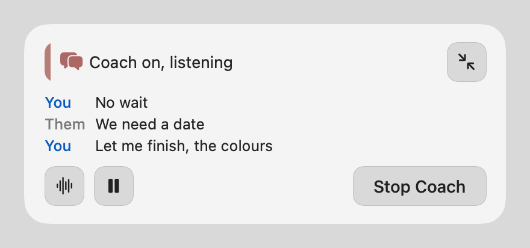 | 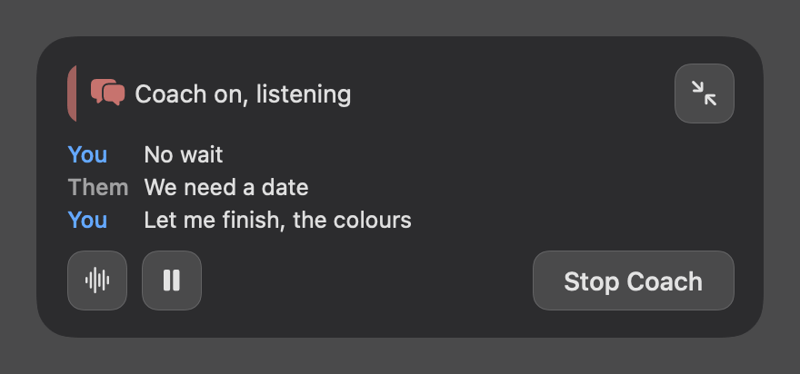 |
| C. Glyph state, 10 s later (lingering) | 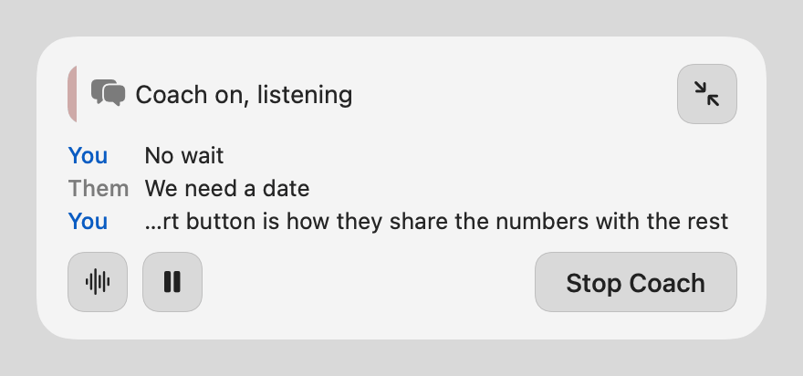 | 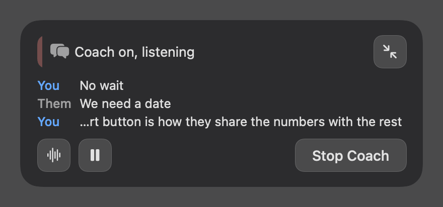 |
| C. Glyph state, 10 s later, hover | 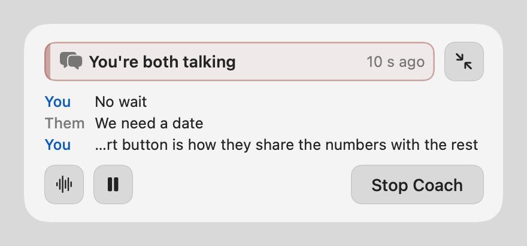 | 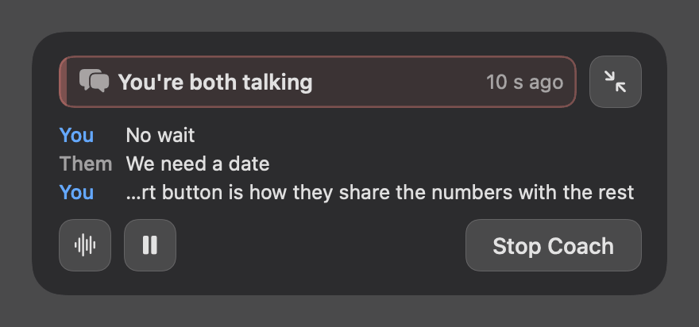 |
| D. Caption-anchored | 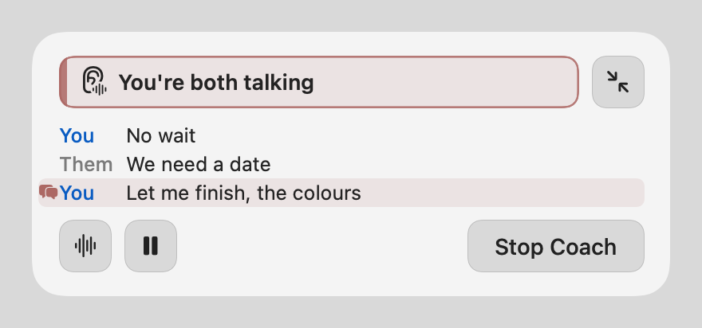 | 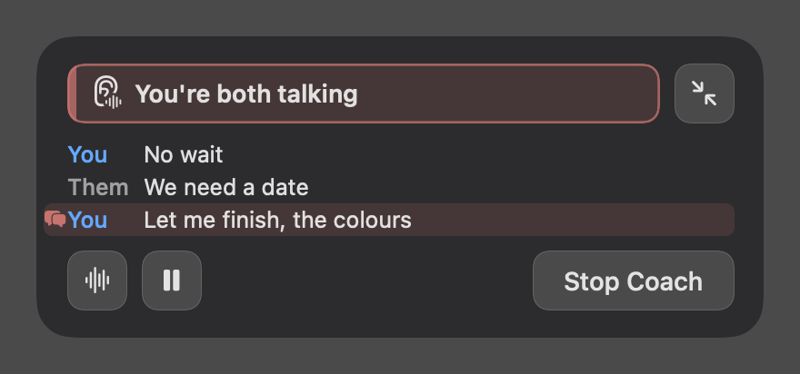 |

### The pill, during a cue

| | Light | Dark |
|---|---|---|
| A. Rotating line (D is the same: no captions in the pill) | 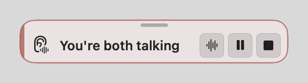 |  |
| C. Glyph state |  |  |
| C. Glyph state, 10 s later, hover | 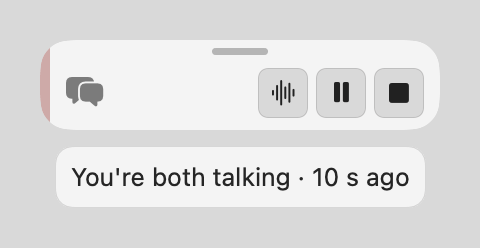 | 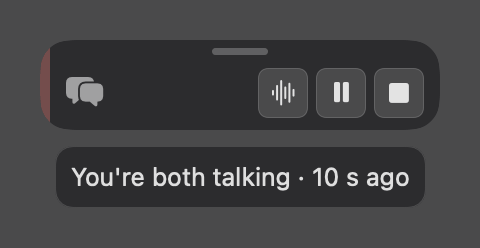 |

### The glyph vocabulary (C, and D's marks)

| Light | Dark |
|---|---|
| 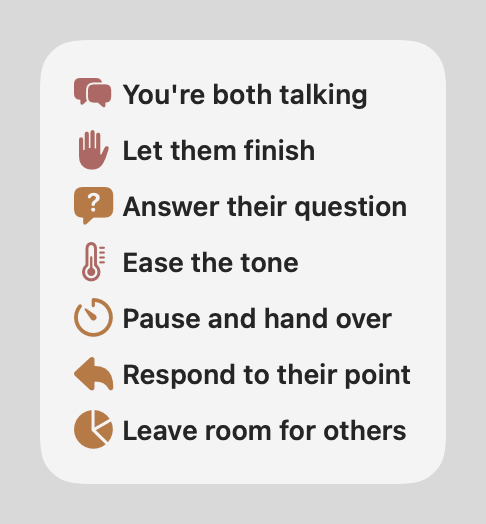 | 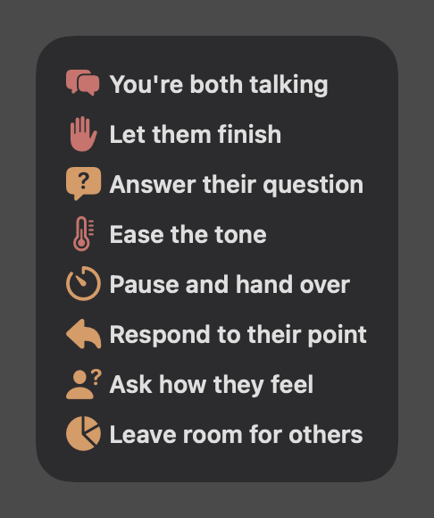 |

### A burst: five cues in 6 s

Synthetic, denser than the shipped policy allows. At 9 s the interrupt shows; the talk-over (10.6 s) waits, then
gives way to the missed question (12 s), which asks the opposite; heat (13.5 s) and not-listening (15 s) don't
outrank it. At 16 s nothing new has shown (the card rests). At 19 s the gap opens and the question shows, 7 s late
but still within its 20 s shelf life. At 25 s the card rests again.

Card, light:

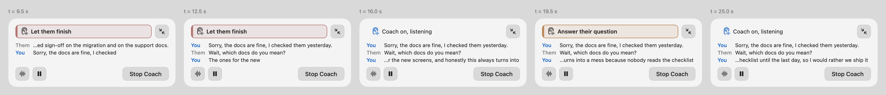
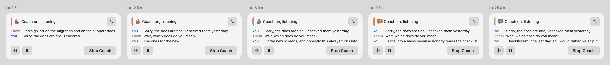
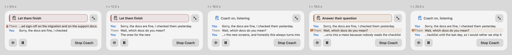

Card, dark:

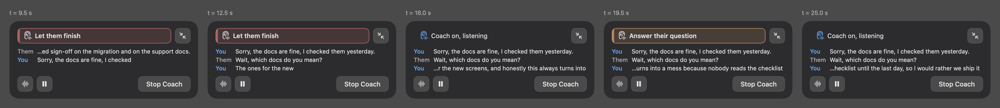
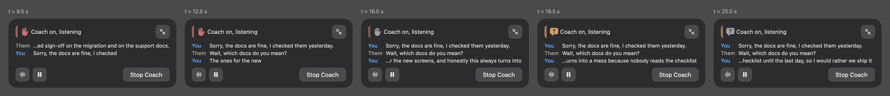
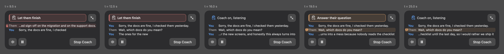

Pill (rotating line, then glyph state; caption-anchored's pill is the rotating line's), light and dark:

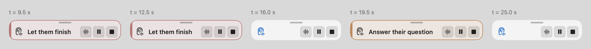
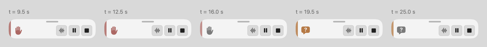
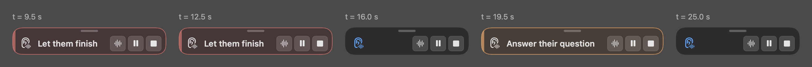
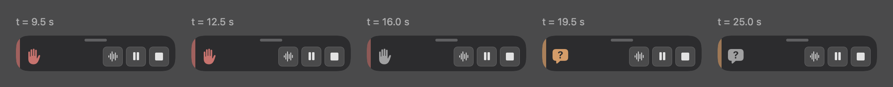

### The recorded busy call before pacing

The harness run with cooldowns at 0: the interrupt (7.7 s) and the missed question (24.5 s, which clears the
interrupt's linger: opposite advice) show; the talk-over (29.6 s) waits and is dropped at 34.5 s, past its 6 s
shelf life.

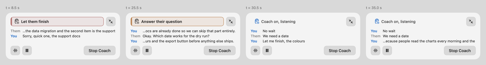
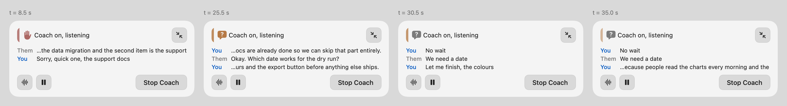
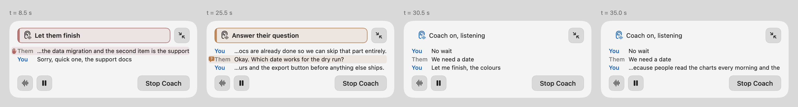

The before-pacing strips in dark mode, and caption-anchored's pill (identical to the rotating line's), are only
in the CI artifact; the images here are compressed with `pngquant 64` to keep the repository light (CI checks
the sizes).

## Recommendation

**Keep the rotating line on the card (A), add C's linger to its status glyph, use the glyph state (C) on the pill,
and don't build caption anchoring (D) or the stack (B) now. Keep the 10 s display gate.**

- With the shipped policy the display sees at most one cue per 20 s (the harness never showed two closer than
  21.9 s), so the options differ in **what a glance shows**, not in burst handling. The gate makes every option
  behave in a burst; it costs nothing today.
- The urgent cues (interrupt, talk-over, monologue: 10 of the 11 cues the harness showed) are actionable
  mid-sentence, and **words act faster than a glyph that has to be decoded**. That favors A on the card, where
  there's room for them.
- A's weakness is that the words vanish after 4.5 s. Letting the cue's glyph stay in the status glyph for the rest
  of the linger (C's decay: tone, then neutral, then gone) gives a later glance a trace of what happened, with no
  extra motion and no space.
- The pill exists to be small and stable. C keeps its width and carries the cue in the glyph; A's widening is the
  most visible motion of any option. Words stay one hover away, and VoiceOver users get them from the
  announcement either way.
- D needs captions (opt-in, with a key) and its mark scrolls out quickly; B costs a caption row for an item that is
  almost always alone and can show opposite advice side by side. Revisit D if captions turn out to be widely used.

## Open questions for the owner

1. **Card**: words for the hold plus a lingering glyph (recommended), or the glyph state on the card too?
2. **Pill**: glyph only with words on hover (recommended), or keep the shipped widening pill?
3. **N = 10 s**: fine as a display gate? (It never acts under the shipped 20 s policy.)
4. **Glyph set**: are the seven glyphs right, in particular the thermometer for heat and the timer for monologue?
5. **Copy**: the writer needs the strings listed in the PR (ages, VoiceOver labels, the lab's labels).

## Comparing the options on a Mac

In the test build, the coach menu bar menu has **Cue Display Prototype…** (under Settings…). It opens a window
with the option, the timeline (the recorded harness runs and the synthetic burst), Card or Pill, light, dark or
system appearance, and the hover detail; Play (1×, 2×, 4×) or scrub, and read what the display did with each cue
below. It plays fixed timelines only: no call, no audio, nothing saved. The shipping app has none of it. The hand
check is row **CD1** in [MAC_DEMO_CHECKS.md](MAC_DEMO_CHECKS.md).

## How the evidence was gathered

- Inventory: read from `ListenMoreCore` (`CuePolicy`, `LocalLayer`, `TextRules`, `CoachPipeline`, `GptLayer`,
  `DefaultConfig`) and MeetingCard's `CoachController`, not from the docs.
- Frequency: PR #30's harness at `2afe949`, built on Linux (Swift 6.2.3) in a separate checkout, with a scratch
  probe added to that copy only (not committed anywhere) to dump each run's lines and cues, at shipped pacing and
  with `cues.cooldown_s` and `cues.global_cooldown_s` at 0. PR #30 itself is unchanged.
- The pacing, conflict, stale and anchor rules are unit-tested in `swift/Tests/CueDisplayTests.swift` (they also
  run on Linux); the surfaces in `swift/Tests/CueDisplaySnapshotTests.swift`.
