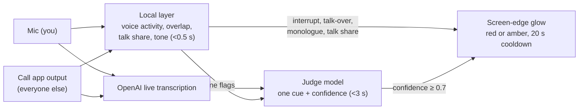

# How the coach works

The listen-more coach watches the shape of your conversation during a call and gives you a quiet visual nudge when you start to dominate it. It never plays a sound, and it keeps nothing after the call ends.

## Who is talking

The coach listens to two separate audio streams. Your microphone is "you", and the call app's output is "everyone else". Because the streams are separate, the coach knows who is speaking without any voice recognition.

## Two layers of detection

**Local layer (on your Mac, under 0.5 s).** Voice activity detection runs on each stream. From that it tracks:

- **Interrupt:** you start speaking while someone else is talking, after a short grace window.
- **Talk-over:** both sides speak at once for more than about 1 s.
- **Monologue:** you speak for more than 75 s without a break.
- **Talk share:** you hold more than 55% of the talk time over the last 5 minutes.
- **Tone flags:** your loudness and speaking rate, compared with your own baseline from earlier in the same call.

**GPT layer (under about 3 s).** OpenAI transcribes speech live. A judge model reads the recent turns plus the local tone flags and returns at most one cue (aggressive, missed question, not listening, or occasionally an interruption the local layer missed) with a confidence score and a short reason. Requests use `store: false`, and each call has a budget cap (default $1).

## The cue

A cue is a glow at the edge of your screen:

- **Red:** interrupt, talk-over, or aggression.
- **Amber:** not listening, a missed question, a monologue, or high talk share.

A cue from the judge model only fires when its confidence is 0.7 or higher. The glow plays once over about 3 s: a quick rise, a short hold, then a slow fade (with Reduce Motion on, it appears and fades over 2 s). It shows on the display with the call app's window. Each cue type has a 20 s cooldown, so you won't see the same nudge twice in a row.

## Starting and stopping

The coach starts on its own when an allowlisted call app (or any app, if you turn that on in Settings) has both the microphone and speakers active for about 3 s. It stops about 30 s after either one goes off, or, for a meeting you joined from a MeetingCard card, when that calendar event ends.

## Privacy

Everything stays in memory. Nothing is written to disk, no transcripts or stats are kept, and logs contain no call content.

