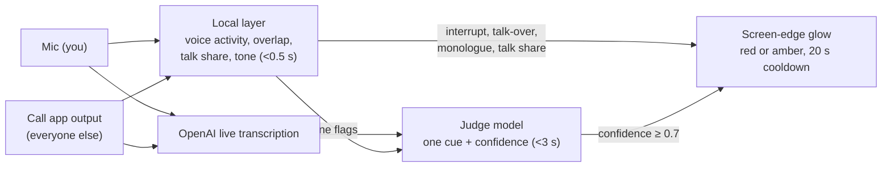

# How the coach works

The listen-more coach watches the shape of your conversation during a call and gives you a quiet visual nudge when you start to dominate it. It never plays a sound, and it keeps nothing after the call ends.

## Who is talking

The coach listens to two separate audio streams. Your microphone is "you", and the call app's output is "everyone else". Because the streams are separate, the coach knows who is speaking without any voice recognition.

## Two layers of detection

**Local layer (on your Mac, under 0.5 s).** Voice activity detection (the WebRTC detector) runs on each stream. From that it tracks:

- **Interrupt:** you start while someone else is talking and keep going: at least 0.6 s of overlap, with them still talking for 0.5 s and you past a short "mm-hm". Starting as they finish only counts if their last words were unfinished ("and", "but", "so" …).
- **Talk-over:** three or more back-and-forth switches within 4 s, with real overlap, ending with you holding the floor.
- **Monologue:** a soft nudge after 60 s of you talking without a break (earlier if that is well past your usual turn length in this call, never under 30 s) and a stronger one at 90 s.
- **Talk share:** you hold more than 65% of the talk time over the last 10 minutes (70% in a one-on-one), once there is at least 5 minutes of speech.
- **Tone flags:** your loudness and speaking rate, compared with your own baseline from earlier in the same call.

**Transcript rules (on your Mac).** OpenAI transcribes speech live, and simple rules run on the transcript in memory: a question to you that your reply drifts away from, and heated phrasing (absolutes, frustration, repeating yourself; word choice alone also needs a rise in your tone). Heat is never flagged in the first 5 minutes or right after an apology.

**GPT layer (under about 3 s).** A judge model reads the recent turns plus the local tone flags and returns at most one cue (aggressive, missed question, not listening, or occasionally an interruption the local layer missed) with a confidence score and a short reason. Requests use `store: false`, and each call has a budget cap (default $1).

## The cue

A cue is a glow at the edge of your screen:

- **Red:** interrupt, talk-over, or aggression.
- **Amber:** not listening, a missed question, a monologue, or high talk share.

A cue from the judge model only fires when its confidence is 0.7 or higher. The glow plays once over about 3 s: a quick rise, a short hold, then a slow fade (with Reduce Motion on, it appears and fades over 2 s). It shows on the display with the call app's window. Each cue type has a 20 s cooldown, so you won't see the same nudge twice in a row.

## Starting and stopping

The coach starts on its own when an allowlisted call app (or any app, if you turn that on in Settings) has both the microphone and speakers active for about 3 s. It stops about 30 s after either one goes off, or, for a meeting you joined from a MeetingCard card, when that calendar event ends.

Core Audio is the fallback signal, and it lags: a call app can keep the mic and speakers open after you leave. The trigger therefore accepts an optional app-level call-state signal (`CallStateProvider`: started, ended or muted per app). When that signal reports a call ended, the coach stops about 3 s later (`ended_stop_after_s`) and doesn't restart for that app while its audio stays open. Started and muted never start or hold a session. MeetingCard doesn't ship a provider yet, so today the 30 s Core Audio stop applies.

## Without an API key

The coach turns on without a key. It then runs the local layer only (interruptions, talk-over, monologue and talk share), and nothing is sent anywhere. The transcript rules and the GPT layer need the transcription and judge calls, so they stay off until a key OpenAI accepts is saved. A saved key that OpenAI rejects is flagged in Settings and the coach menu, and the coach keeps running local-only.

## Privacy

Everything stays in memory. Nothing is written to disk, no transcripts or stats are kept, and logs contain no call content.

