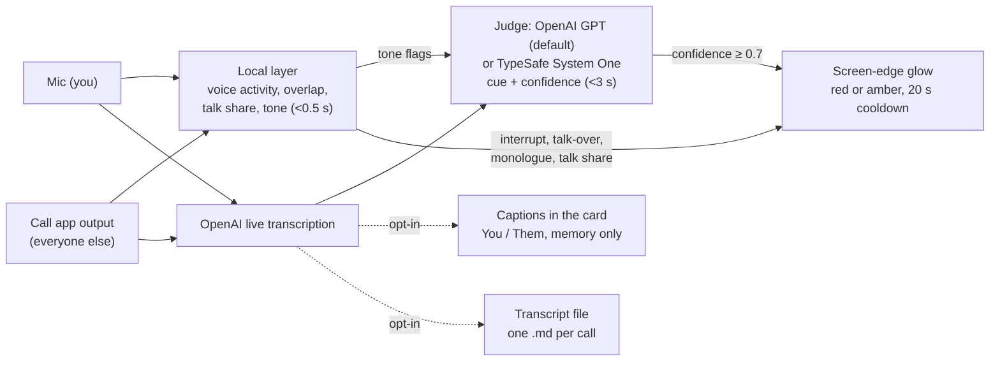

# How the coach works

The listen-more coach watches the shape of your conversation during a call and gives you a quiet visual nudge when you start to dominate it. It never plays a sound, and it keeps nothing after the call ends.

## Who is talking

The coach listens to two separate audio streams. Your microphone is "you", and the call app's output is "everyone else". Because the streams are separate, the coach knows who is speaking without any voice recognition. Captions and saved transcripts use the same split: lines are labelled **You** (mic) and **Them** (call audio). "Them" is not split further into individual speakers (see [Speakers](#speakers)).

## Two layers of detection

**Local layer (on your Mac, under 0.5 s).** Voice activity detection (the WebRTC detector) runs on each stream. From that it tracks:

- **Interrupt:** you start while someone else is talking and keep going: at least 0.6 s of overlap, with them still talking for 0.5 s and you past a short "mm-hm". Starting as they finish only counts if their last words were unfinished ("and", "but", "so" …).
- **Talk-over:** three or more back-and-forth switches within 4 s, with real overlap, ending with you holding the floor.
- **Monologue:** a soft nudge after 60 s of you talking without a break (earlier if that is well past your usual turn length in this call, never under 30 s) and a stronger one at 90 s.
- **Talk share:** you hold more than 65% of the talk time over the last 10 minutes (70% in a one-on-one), once there is at least 5 minutes of speech.
- **Tone flags:** your loudness and speaking rate, compared with your own baseline from earlier in the same call.

**Transcript rules (on your Mac).** OpenAI transcribes speech live (a segment under 100 ms of audio isn't sent for transcription on its own, since OpenAI refuses a commit that short; its audio goes with the next segment, and if OpenAI refuses a commit anyway, only that one is skipped and transcription carries on), and simple rules run on the transcript in memory: a question to you that your reply drifts away from, and heated phrasing (absolutes, frustration, repeating yourself; word choice alone also needs a rise in your tone). Heat is never flagged in the first 5 minutes or right after an apology.

**GPT layer (under about 3 s).** A judge model reads the recent turns plus the local tone flags and returns at most one cue (aggressive, missed question, not listening, or occasionally an interruption the local layer missed) with a confidence score and a short reason. Requests use `store: false`, and each call has a budget cap (default $1).

**Cue judge.** Settings picks who judges your reply (`judge.provider`). **OpenAI GPT** is the default and works as described above. **TypeSafe System One** asks a TypeSafe endpoint one fire / no-fire question per judged cue (aggressive, not listening, missed question). It sees only a minimal window: at most 8 transcript lines from the last 30 s, each labelled ME or OTHERS with how many seconds ago it was heard, and with links, email addresses, runs of five or more digits and your configured names redacted. No audio, tone flags or prompt go to it. A fire answer below confidence 0.7, an error or no answer within 6 s gives no cue. Three failed calls in a row stop judging for that call, while transcription and the transcript rules keep running. The transcript rules still raise heat and missed questions themselves; the cooldowns keep it to one glow. Settings then says why judging stopped (for example the key wasn't accepted, or TypeSafe didn't answer in time). Each call's latency and the `usage` tokens TypeSafe reports are recorded (TypeSafe reports cost as tokens per call-hour, with no dollar rate), and a per-call price (`cost_usd_per_call`, unset by default) counts toward the budget cap only when you configure one. Transcription stays with OpenAI.

## The cue

A cue is a glow at the edge of your screen:

- **Red:** interrupt, talk-over, or aggression.
- **Amber:** not listening, a missed question, a monologue, or high talk share.

A cue from the judge model only fires when its confidence is 0.7 or higher. In MeetingCard, not listening nudges are off by default, and while they are off the judge isn't called at all. Each cue also tints the coach card (or its pill) amber or rose for 4.5 s with a few words saying what it was, so color is never the only cue, and VoiceOver reads it. The glow plays once over about 3 s: a quick rise, a short hold, then a slow fade (with Reduce Motion on, it appears and fades over 2 s). By default it shows on the display holding the call app's largest window. With the `callWindowBinding` feature flag on (it ships off; see "Feature flags" in the README), it shows on the display with the call's window: the window that opened with the call (Zoom's meeting window, never its home window), kept through the home window closing, other windows opening and the meeting being minimized (then Zoom's mini window, if any, stands in), or for Meet with Use Zoom/Meet controls on, the browser window holding the meeting tab. It's picked from window numbers, owners, layers and bounds only (no titles) and when the window appeared, never by size or which window is in front; when no window can be identified, the glow uses the card's display. Each cue type has a 20 s cooldown, so you won't see the same nudge twice in a row.

**Which window is the call's** (only with the `callWindowBinding` flag on; off, the glow follows the call app's largest window and Zoom reads from its menu alone). Setting: `trigger.call_window_lookback_s`, default 60 s, next to `judge.provider` and the other settings in `DefaultConfig.swift`:
- **First bind (Zoom; other apps: see Known gaps):** the newest normal window that opened no earlier than 60 s before the coach started for the call.
- **Re-resolve:** when that window closes (a preview or waiting-room window giving way to the meeting window), the newest window that opened since the coach began watching and is still open binds, with no 60 s limit. Windows that opened while another one was bound (Settings, Chat) never take over. If only those are left, the glow uses the card's display. That's expected, not a bug.
- **Waiting room:** if the meeting window opens before the preview or waiting-room window closes, it opened while another window was bound, so it never takes over. When the preview closes, nothing is bound and the glow uses the card's display for the rest of that call. That's expected, not a bug (hand check ZW1b accepts it).
- **Two windows at once:** two windows that first appear in the same half second can't be told apart, so neither binds. That lasts while both stay open: the next window that opens (Chat, say) is the newest and binds, or one of the two closing lets the other bind. That's expected, not a bug.
- **The window never keeps the coach running:** it only stops the Zoom home window in front from reading as "call ended". When the mic and call audio go quiet, the coach still stops about 30 s later (or about 3 s after an ended report), even while a "meeting ended" or post-call window stays open. In the cases above where nothing is bound (waiting-room overlap, a tie, a restarted session, a coach started mid-call) there is no window to hold the call on, so with Zoom's home window in front the call can read as ended and the coach stops about 3 s later, same as without window following.
- **Coach turned on mid-call:** the glow uses the card's display for that call, because every Zoom window was already open and none can be told apart as the meeting's. That's expected, not a bug. The next call binds normally (Zoom; other apps: see Known gaps).
- **Coach stopped and started again mid-call:** a new session only binds windows that opened in the 60 s before it started, so the meeting window that was already open doesn't bind, and the glow uses the card's display for the rest of that call. That's expected, not a bug.
- **Coach any app:** an app that isn't on the allowlist is watched only from the moment its session starts (as is every native app other than Zoom, see Known gaps), so windows it already has open never bind and the glow uses the card's display. A window it opens after that can bind.
- **What is read, and when:** the window list (CGWindowList) is read on each coach poll (every half second) only for Zoom, which is watched whenever it runs so the 60 s lookback works, and for any other native call app (Slack, Teams, Webex, FaceTime, or a coach-any-app session's app) only while a coach session is active for that app. A browser (Chrome, Dia) is never listed in the window list until the Meet check has named the window holding a meeting, so Chrome or Dia open all day with no Meet call costs no window-list reads. The list of running apps is still read on every poll.

**Known gaps (call window):**
- Apps other than Zoom have no first-bind lookback. Slack, Teams, Webex, FaceTime and any other native app are watched only while a coach session is active for them, and a session starts about 3 s (`trigger.start_after_s`) after the call's audio starts. By then the call window is usually already open (a Teams meeting or prejoin window, a FaceTime call window), so it can't be told from the home window and never binds, and for these apps the glow usually uses the card's display. Only a window the app opens after the session starts can bind, such as a screen-share or pop-out window. For a manual start with no app yet, the first read happens when the app qualifies. This keeps the window list from being read every half second all day for apps that are often running. It is easy to widen again (add them to `alwaysOnKeys` where `CoachService` calls the tracker) if the hand check shows the read is cheap.

## Starting and stopping

The coach starts on its own when an allowlisted call app (or any app, if you turn that on in Settings) has both the microphone and speakers active for about 3 s. It stops about 30 s after either one goes off, or, for a meeting you joined from a MeetingCard card, when that calendar event ends.

Core Audio is the fallback signal, and it lags: a call app can keep the mic and speakers open after you leave. The trigger therefore accepts an optional app-level call-state signal (`CallStateProvider`: started, ended or muted per app). When that signal reports a call ended, the coach releases the microphone right away, stops about 3 s later (`ended_stop_after_s`) and doesn't restart for that app while its audio stays open. While it reports the session's app muted, the coach holds capture the same way Pause does (no capture, no streams) and resumes on unmute; your own Pause stays in place until you resume. Started and muted never start or hold a session.

The coach menu has its own **Mute My Mic for Coach**, separate from the card's **Mute in Zoom** control and from Zoom's own mute. It stops the coach's mic engine (the input device is released and voice processing is off), so no mic audio goes to OpenAI and no You text is produced, while call audio, Them captions and the cues about the other side carry on; the card reads "Coach is hearing others only" and the chip "Coach can't hear you". A line you were still saying, or had just finished, when you pressed Mute is dropped rather than transcribed (the transcriber is told to clear it). If OpenAI refuses that clear, nothing stops: the other side keeps streaming and being captioned, the refusal is logged by its event type only (no audio, no text), and the clear is sent again at Unmute before any new mic audio. The cues that read your speech can't fire from the gap or because of it:
- **Interrupt** (cut-in) and **talk-over**: nothing to detect while muted; a pending cut-in and the speaker-switch log are dropped at Mute and Unmute, and for `local.unmute_grace_s` (1 s) after Unmute your speech opens no cut-in and counts as no switch, while the echo canceller restarts with the mic.
- **Monologue**: your turn in progress is dropped (no shortened run enters your usual run length); a new turn starts after Unmute.
- **Missed question**: a pending question is dropped at Mute and Unmute, and questions asked while you're muted don't open one.
- **Not listening** (off by default in MeetingCard) and the TypeSafe judge: the "they spoke, now you reply" trigger starts over at Mute and Unmute, so your first line back isn't judged as a reply to the gap.
- **Talk share** keeps counting, with you silent (what the call heard), so the gap can only lower your share. **Heat** has none of your text to read while muted.

It lasts until **Unmute My Mic for Coach** or until the session ends (the next call starts unmuted), and it survives Pause and Zoom's own mute, so resuming keeps the mic off. It never touches the call app: no Accessibility, no Automation, no new permission.

MeetingCard's provider is the **Use Zoom/Meet controls** setting (off by default). Without it, or for any app whose permission is missing, revoked or unsupported, the 30 s Core Audio stop applies.

- **Zoom** (Accessibility): in a meeting while Zoom's menu bar has its in-meeting shortcuts (⇧⌘A mute/unmute audio, ⇧⌘V start/stop video). Leaving (or closing the meeting window, or quitting Zoom) removes them, which reads as ended. Muted while the ⇧⌘A item offers Unmute. That item's label is the only text read, and it's reduced to muted or not on the spot. Zoom in another language: start and end work, and mute stays unknown (the coach keeps listening while muted). The coach card's **Mute in Zoom** control (`CallControlsModel.toggleMute()`) presses that same ⇧⌘A item once through Accessibility (no synthesized keys or events) and reads Zoom's mute state back right after. It shows only while it can act: Use Zoom/Meet controls on, Accessibility granted, Zoom in a meeting and the reading not held. With the `callWindowBinding` flag on, the reading is held when Zoom's menu shows no in-meeting shortcuts (neither ⇧⌘A nor ⇧⌘V) while the call's window is still open, for example with Zoom's home window in front mid-call: the coach keeps listening on the held reading (and a held muted state still shows), but the control is hidden until the shortcuts are back. Otherwise (`toggleOff`, `permissionDenied`, `noZoomCall`, `meet`) it's hidden, and the pill keeps the coach's own Mute, Pause and Stop.
- **Meet in Chrome and Dia** (Automation, AppleScript): in a call while any tab is a `meet.google.com` meeting (`/abc-defg-hij`). The browser itself narrows its tabs to the Meet host (`whose URL starts with`), the script checks the meeting path and returns only a count, so no title and no other URL leaves the browser. **Meet mute is not detected**: Meet's mute state isn't readable without page content, so it's never reported, and muting in Meet (Chrome or Dia) doesn't pause the coach. Only Zoom's mute does. There is no mute action for Meet either (`canMute` is false with reason `meet`: mute from Meet), and that control never "mutes" by stopping the coach's own audio capture. Dia lists a window's tabs per space, so its script walks every space. Dia added AppleScript in 1.7.0. On a Dia that can't list tab URLs this way (an older Dia, or one without `whose` on tabs), Dia falls back to Core Audio.

An ended call is reported for up to `stop_after_s` (30 s) after it ends; after that Core Audio decides again.

On headphones, wired or Bluetooth, the coach uses no voice processing, so nothing is lowered. With Bluetooth output it always uses the Mac's built-in mic, so AirPods never switch to the hands-free profile; a Mac with no built-in mic then runs on call audio only, and shows a one-time notice on the coach card and a note in Settings that mic cues are off while Bluetooth headphones are used. The coach never opens a Bluetooth input. With the lid closed, if the built-in mic delivers no audio, or only digital silence, for 3 s, the coach sets it aside and runs on call audio only instead of capturing silence; it tries the mic again when the audio routes really change or on the next call. If the mic fails to open, at the start of a call or later, the coach doesn't give it up: it keeps the call's audio going, keeps watching the audio routes, and tries the mic again (at most three tries in 30 s) for as long as the call runs and you haven't muted the coach, so a mic that wasn't ready at the start still comes back. Settings keeps showing its note that the mic or call audio didn't start until the next call. The log says only that an open failed, with the route and mic source, and for a set-aside mic how many buffers arrived and how many had any sound, which tells no buffers from silence; it never names a device. On speakers it uses Apple's voice processing, so call audio isn't mistaken for you, and sets the lowering of other audio to Apple's minimum. Pause, the coach's Mute and, with **Use Zoom/Meet controls**, being muted in Zoom or leaving the call release the mic at once (without it, leaving the call releases it at the 30 s stop), and a change of output or input reopens it on the new route.

## Without an API key

The coach turns on without a key. It then runs the local layer only (interruptions, talk-over, monologue and talk share), and nothing is sent anywhere. The transcript rules and the GPT layer need the transcription and judge calls, so they stay off until a key OpenAI accepts is saved. A saved key that OpenAI rejects is flagged in Settings and the coach menu, and the coach keeps running local-only.

## Live captions and saved transcripts (opt-in)

Both are off by default, in Settings under **Captions and transcript**, and both need a key OpenAI accepts: they show the text of the same live transcription the GPT cues already use, so they add no API calls and no cost. The first time either one is turned on, a notice explains that the other people on the call are being transcribed and that you are responsible for telling them and for following the law and any policies that apply to you. "Not Now" leaves the feature off.

- **Live captions.** Shown in the coach card's captions area during a call (the reminder card turns into the coach card); captions have no window of their own. The card hosts `CaptionFeedView` in its compact card layout: up to three of the newest lines as they are transcribed, each labelled with its speaker; consecutive turns by the same speaker within 4 s share a line, and long lines keep their newest words. Captions are in memory only (at most three lines) and are dropped when the call ends.
- **Saved transcripts.** One Markdown file per call, `Call <date> <time>.md`, in `~/Library/Application Support/MeetingCard/Transcripts` unless you choose another folder (a `build.sh --test-id` build uses `MeetingCard-Test/Transcripts` and keeps its own settings, so it never shares transcripts or the Save transcripts setting with the real app). Each finished line has its time since the call started and its speaker label. While a file is being written, a "Saving transcript" badge shows on the coach card's status line (even with captions off, and under a nudge), in Settings, and in the coach menu; with saving off the card shows nothing about it. Settings and the coach menu can delete the current or last transcript; deleting during a call stops saving for the rest of it. The file is readable by your user only (mode 600).
- **Speaker names.** During a call you can rename "You" or "Them" in Settings. Names last for that call only; they are kept only inside that call's saved transcript, if saving is on.
- **Cost cap.** When a call reaches its cost cap, the transcription stops: captions show that they stopped, the transcript file is finished, and the on-device cues continue. The Settings cost line shows the call's spend so far, with captions and transcript at $0.00 extra.

### Speakers

Only "You" and "Them" are labelled. OpenAI's live transcription model (`gpt-live-transcribe`) returns no speaker labels. Its one diarizing model, `gpt-4o-transcribe-diarize`, works only on uploaded files (`POST /v1/audio/transcriptions`, 25 MB per request, about $0.006 per minute), not on live streams, and it is deprecated with a shutdown date of February 26, 2027. Telling "Them" apart would mean holding call audio in memory, uploading it in chunks for a second paid transcription, and matching speakers across chunks, with labels arriving minutes late, on a model that is about to be retired. MeetingCard doesn't do that.

## Privacy

Audio stays in memory in every mode and is never written to disk. With saving off (the default) nothing is written to disk at all: captions and transcript text stay in memory and are gone when the call ends. With saving on, the only write is that call's one transcript file in the folder you chose. No stats are kept, and logs contain no call content, transcript text or keys.

